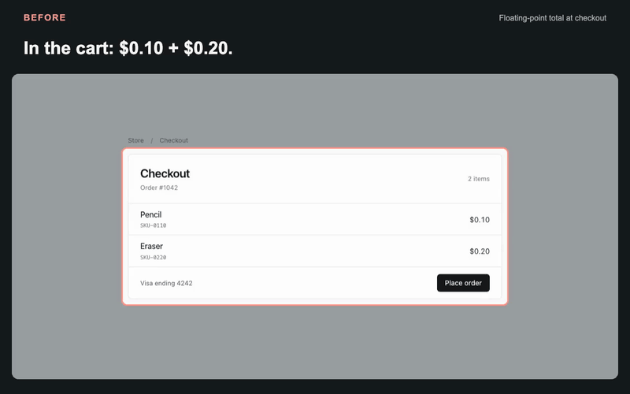

# Fixtape

**Show the bug and its fix in one film.**



[Watch the film](docs/media/film.mp4) · [Local playback page](docs/index.html)

An agent skill that records a real browser action before and after a fix, checks both results, and presents them sequentially in one 1280 × 800 MP4. Camera moves and captions guide the viewer while the original recordings remain available.

## Install from this checkout

From the repository root:

```sh
npx skills add . --skill fixtape -a codex -a claude-code --copy
```

This installs the skill for Codex and Claude Code. The repository is currently a local checkout; a remote installation URL can be added when it is published.

Ask your agent:

> Use $fixtape to show this bug and its fix in one film. Record the same action on both versions, verify the results, and keep the full source clips.

## Try the demo

Prerequisites: **Node.js 22.20 or later**, and **FFmpeg with `libx264` and `ffprobe`** on your PATH.

Run setup once. It installs the pinned dependencies and Playwright Chromium. The renderer reuses that browser; it needs no desktop editor or separate Puppeteer browser download.

```sh
node skills/fixtape/scripts/fixtape.mjs setup
node skills/fixtape/scripts/fixtape.mjs demo --out recordings/first-demo
node skills/fixtape/scripts/fixtape.mjs preview recordings/first-demo
```

Open the printed local URL and play the film. It shows the before sequence, then the same action after the fix, with one interface on screen at a time. The preview supports seeking and stays on your machine.

Use a new or empty output directory for each run. To check an existing setup:

```sh
node skills/fixtape/scripts/fixtape.mjs doctor
```

## Record your app

Serve the original and fixed versions, then write a small [scenario](skills/fixtape/references/recording.md) with their URLs, actions, and expected results:

```sh
node skills/fixtape/scripts/fixtape.mjs record /absolute/path/to/story.mjs --out recordings/my-fix
```

Add `--headed` to show Chromium, `--side before` or `--side after` to record one annotated version, or `--max-mb 10` to set the MP4 size limit. Paired recording captures clean footage and creates the film automatically, with a 10 MB limit per MP4.

Share `film.mp4`; keep `film.json` for its source hashes and edit decisions. The film aims for about 20 seconds and is limited to 25 seconds. Each retained source sequence plays continuously at its original speed; only its opening is shortened.

Each side retains `raw.webm`, `reel.mp4`, `poster.jpg`, and `receipt.json`. The output root also contains `film.jpg` and `index.html`. To compose an existing clean pair:

```sh
node skills/fixtape/scripts/fixtape.mjs compose recordings/my-fix
```

The recorder saves local artifacts. It does not edit project source or upload results.

## What the evidence covers

- Real pointer or keyboard input and asserted text, form value, or visible element count.
- Matched before-and-after scenarios at a 1280 × 800 viewport.
- Optional hashes of declared local source files, with their limits recorded in the receipt.

A failed assertion fails the recording. A caption is not evidence of a fix. Play and seek the saved film, and check that its action, framing, and result are understandable before sharing it. Capture timestamps are approximate; the film is not a performance benchmark.

This version supports regular HTML elements in the browser's main document. It does not support iframe contents, canvas or SVG targets, native applications, or mobile device capture. Source hashes do not prove which revision a URL serves.

[Verification and limits](docs/verification.md) · [MIT license](LICENSE)

## Develop

With the prerequisites above: `PUPPETEER_SKIP_DOWNLOAD=true npm ci --ignore-scripts`, `npx playwright install chromium`, then `npm test`.
To refresh the showcase from an inspected recording: `node scripts/build-showcase.mjs recordings/first-demo`.

Film rendering uses [Revideo](https://github.com/midrender/revideo), distributed under the MIT license.
